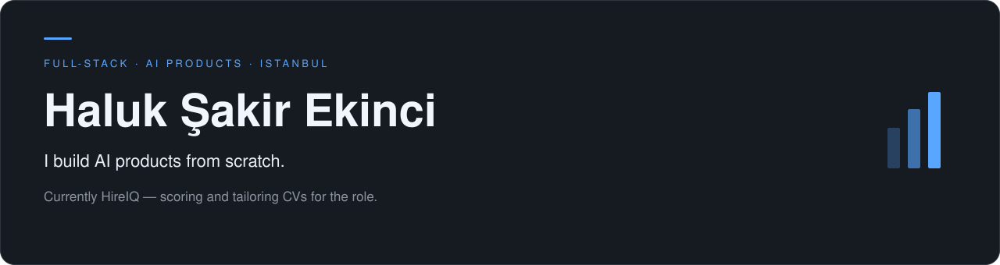
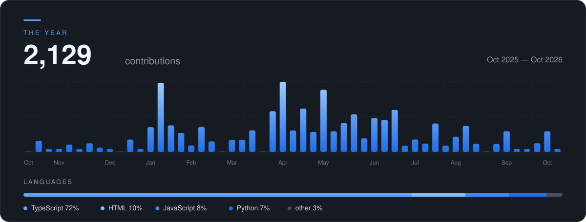

<!-- Haluk Şakir Ekinci – GitHub Profile -->

  

  <a href="https://hireiq.com.tr"><b>HireIQ</b></a>
  &nbsp;&nbsp;·&nbsp;&nbsp;
  <a href="https://www.haluksakirekinci.com.tr">Portfolio</a>
  &nbsp;&nbsp;·&nbsp;&nbsp;
  <a href="https://linkedin.com/in/haluksakirekinci">LinkedIn</a>

 

### Now

<table>
  <tr>
    <td width="50%" valign="top">
      <h3><a href="https://hireiq.com.tr">HireIQ</a></h3>
      
Reads a pile of CVs and scores each one against the role. Paste a job link and it rewrites a CV for that posting.

      Next.js · Gemini · PostgreSQL
    </td>
    <td width="50%" valign="top">
      <h3><a href="https://github.com/Hse38/ai-job-search">ai-job-search</a></h3>
      
Job search that runs on your machine. Evaluate a posting, tailor the CV, draft the cover letter, prep the interview.

      Claude Code · local-first
    </td>
  </tr>
</table>

 

### Stack

  <code>Next.js</code>&nbsp;&nbsp;
  <code>TypeScript</code>&nbsp;&nbsp;
  <code>React</code>&nbsp;&nbsp;
  <code>Tailwind</code>&nbsp;&nbsp;
  <code>Node.js</code>&nbsp;&nbsp;
  <code>PostgreSQL</code>&nbsp;&nbsp;
  <code>Prisma</code>&nbsp;&nbsp;
  <code>Gemini</code>&nbsp;&nbsp;
  <code>Claude</code>

 

  

 

  <i>Istanbul · Open to collaboration · Building in public</i>

